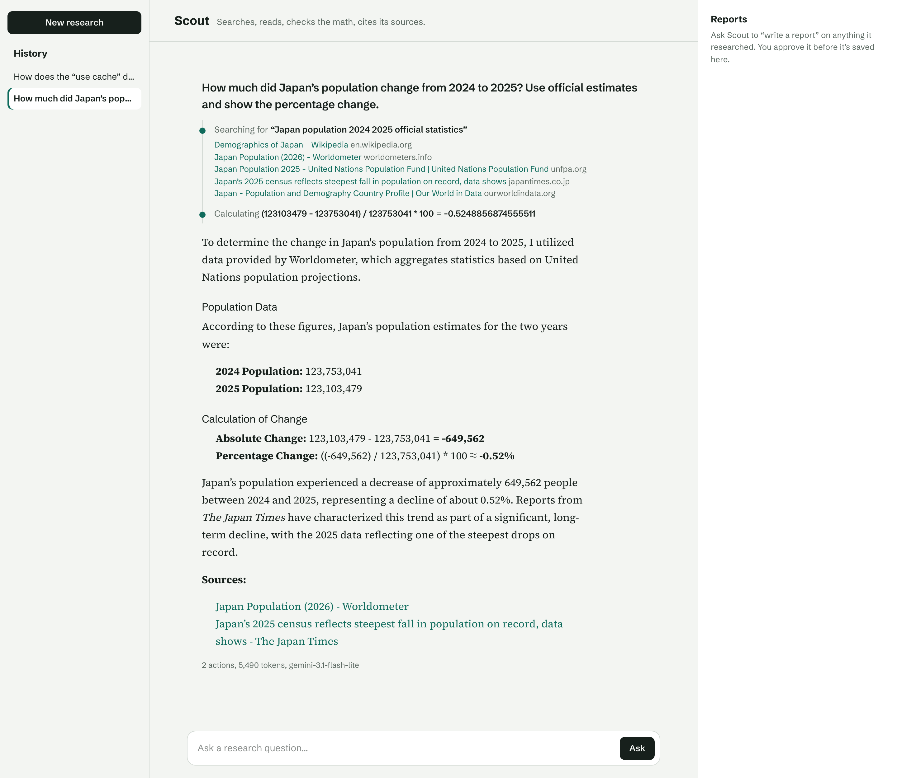
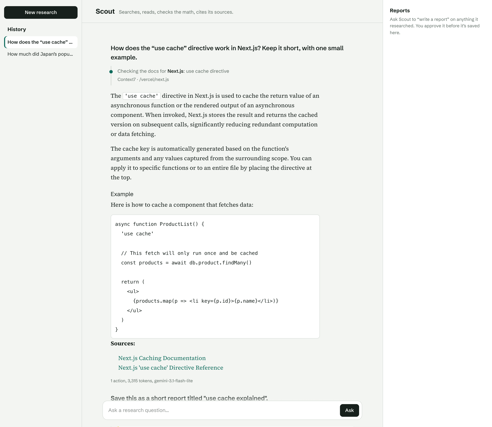
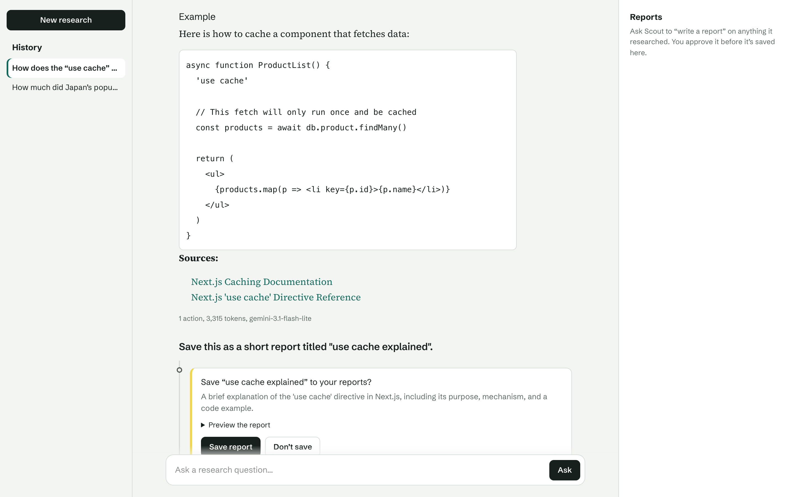
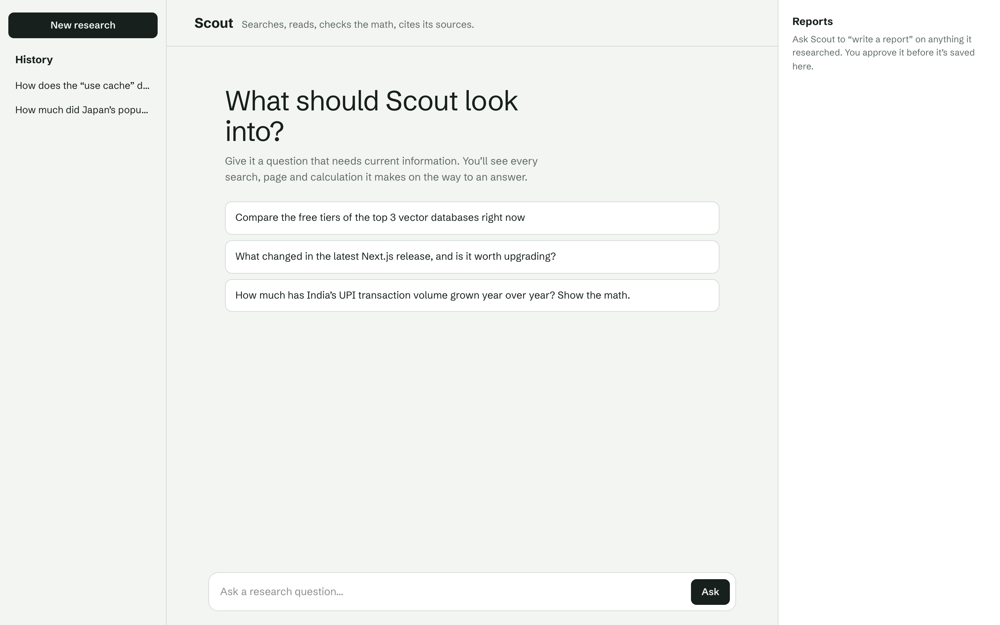
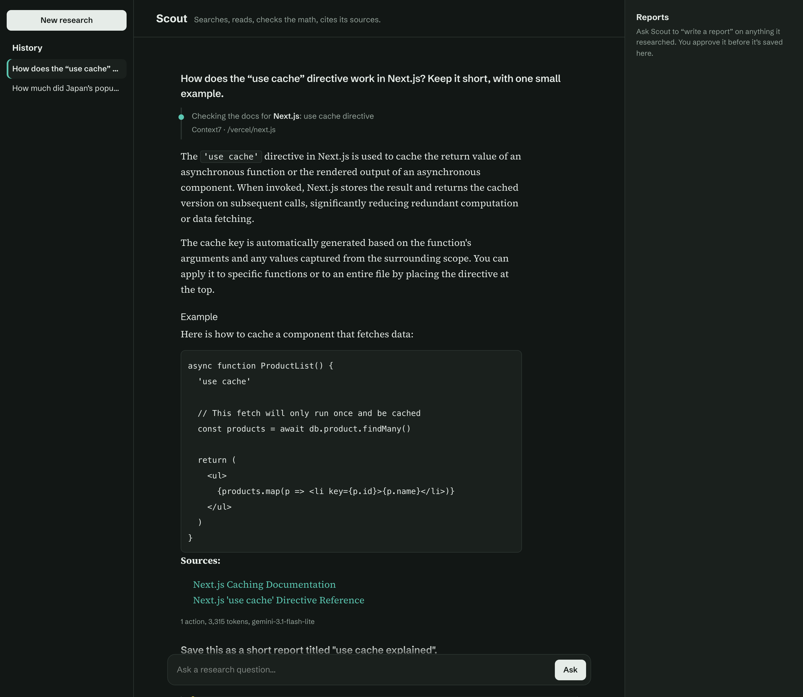

# Scout: an autonomous research agent

Scout takes a research question, plans an approach, searches the live web, reads the most relevant pages, checks numbers with a real calculator, and writes a cited answer. Every action it takes is streamed to the UI as it happens, and saving a report requires the user's approval.

**Live demo:** _add your Vercel URL here_

<!--  -->



| Library docs via MCP (Context7) | Human approval before saving |
|---|---|
|  |  |
| **Start screen and session history** | **Dark mode** |
|  |  |

## Features

- **Multi-step agent loop** built on the Vercel AI SDK `ToolLoopAgent`: the model decides which tool to call next until the task is done, capped at 12 steps as a guardrail.
- **Five typed tools** with Zod schemas: web search (Tavily), page reader, library docs (Context7 via MCP), math evaluator (mathjs), and report saver.
- **MCP client:** Scout connects to the [Context7](https://context7.com) MCP server over HTTPS for current library and framework docs. Its two server tools sit behind one typed `lookupDocs` tool, so the model can only reach an allowlist. The client is opened and closed per call (serverless-safe), unknown libraries are rejected instead of fuzzy-matched, and if the server is down the agent falls back to web search.
- **Live reasoning trail:** each search, page read and calculation streams into the UI in real time with its state (running, done, failed).
- **Human-in-the-loop approval:** the agent must get the user's sign-off before saving a report; denied actions are fed back to the model.
- **Grounded answers:** system prompt enforces source verification, inline citations and no invented URLs or numbers.
- **Safety and reliability:** SSRF protection on the page reader, request timeouts, per-IP rate limiting, bounded context window, user-cancellable runs and retry on error.
- **Model fallback:** language-model middleware catches a 429 (quota) or 503 (overloaded) from the primary Gemini model and re-runs that step on a second model with its own quota, with a short circuit breaker so later steps skip the limited model. A 55s run budget ends stuck runs with a visible "ran out of time" notice instead of a hang.
- **Persistent sessions (Neon Postgres):** every chat is saved as it streams (after each agent step, not just at the end), past sessions are listed in a sidebar and reload at `/c/{id}`, and approved reports are written to their own table.
- **Private per-browser history, no login:** a proxy gives each browser an anonymous httpOnly id cookie. Every chat is stamped with it, reads are filtered by it, and writes to another browser's chat are refused on the server (403).
- **Observability:** structured JSON logs per agent step (tools used, tokens), token usage and model shown per answer.
- **End-to-end type safety:** tool inputs and outputs are inferred into the React UI via `InferAgentUIMessage`.

## Tech stack

Next.js (App Router), React, TypeScript, Vercel AI SDK (`ai`, `@ai-sdk/react`, `@ai-sdk/google`), Gemini, Tavily Search API, Model Context Protocol (`@ai-sdk/mcp`, Context7), Neon Postgres (`@neondatabase/serverless`), Zod, mathjs, react-markdown.

## Architecture

```
Browser (useChat)  ──POST /api/chat──▶  Route handler (rate limit, context trim)
      ▲                                         │  └─ after every step: upsert message ──▶ Postgres: chats, messages
      │  streamed UI message parts              ▼
      └──────────────────────────────  ToolLoopAgent (Gemini)
                                          │  loops: think → call tool → observe
                                          ├─ webSearch  → Tavily API
                                          ├─ readPage   → fetch + HTML→text (SSRF-guarded)
                                          ├─ lookupDocs → MCP over HTTPS → Context7 (library docs)
                                          ├─ calculator → mathjs
                                          └─ saveReport → needs user approval → Postgres: reports
```

## Run locally

```bash
npm install
cp .env.example .env.local   # add your API keys and DATABASE_URL
npm run db:setup             # creates the chats, messages and reports tables
npm run dev                  # http://localhost:3000
```

For the database, create a free project at [neon.tech](https://neon.tech), click **Connect**, and copy the pooled connection string into `DATABASE_URL`. Without it Scout still runs, but history is lost on refresh.

## Deploy

Import the repo on [Vercel](https://vercel.com/new) and add the environment variables:
- **Required:** `GOOGLE_GENERATIVE_AI_API_KEY`, `TAVILY_API_KEY`, `DATABASE_URL`
- **Optional:** `GEMINI_MODEL`, `GEMINI_FALLBACK_MODEL`, `CONTEXT7_API_KEY`

Run `npm run db:setup` once against the database before the first deploy.

## Project structure

```
src/
  app/api/chat/route.ts   agent endpoint (streaming, saves each step)
  app/api/chats, reports  history and report lists for the sidebar and shelf
  app/page.tsx            new session
  app/c/[id]/page.tsx     saved session, loaded on the server
  lib/agent.ts            agent definition, prompt, guardrails
  lib/tools/              webSearch, readPage, lookupDocs, calculator, saveReport
  lib/mcp.ts              MCP client helper (https-only, opened/closed per call)
  lib/model.ts            Gemini model with 429/503 fallback middleware
  lib/chat-store.ts       all SQL: save/load messages, list chats, reports
  lib/owner.ts            anonymous per-browser owner id (cookie set in proxy.ts)
  lib/rate-limit.ts       per-IP limiter
  proxy.ts                issues the owner cookie on first visit
  components/             Chat, SessionList, TrailStep, ReportShelf, Markdown
db/schema.sql             table definitions (npm run db:setup)
```
